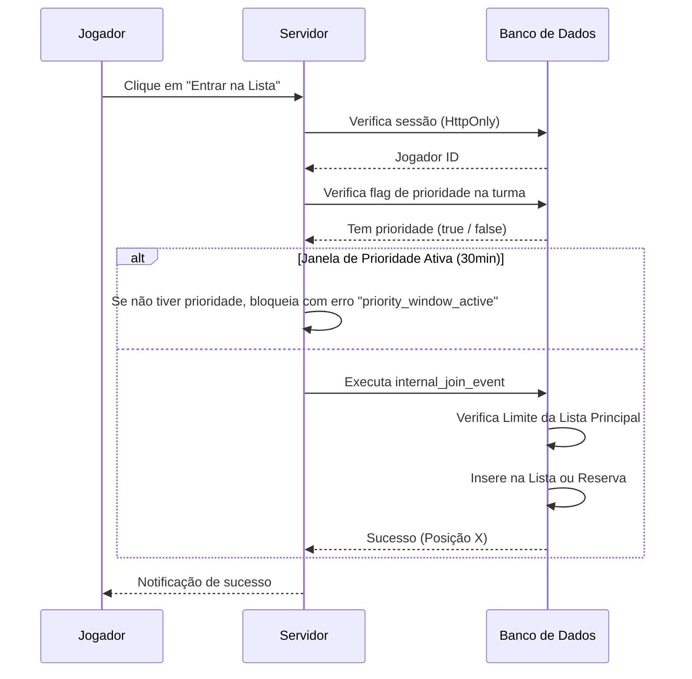
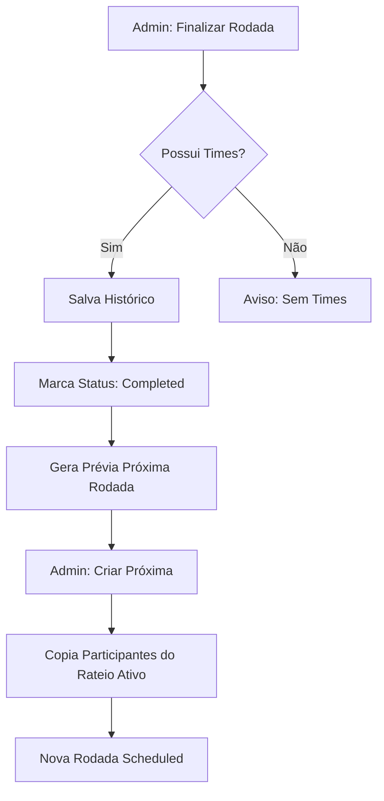

# DOCUMENTAÇÃO TÉCNICA E FUNCIONAL UNIFICADA: SE PASSOU, E PONTO

## 1. Capa e Identificação
**Projeto:** SE PASSOU, E PONTO  
**Versão:** 2.0 (Multi-Turma)  
**Data da Auditoria:** 04/08/2026  
**Stack:** TanStack Start v1, React 19, Supabase, Tailwind CSS v4, Lucide React.  

---

## 2. Índice
1. [Capa e identificação](#1-capa-e-identificação)
2. [Índice](#2-índice)
3. [Resumo executivo](#3-resumo-executivo)
4. [Arquitetura técnica](#4-arquitetura-técnica)
5. [Estrutura de pastas](#5-estrutura-de-pastas)
6. [Perfis e autenticação](#6-perfis-e-autenticação)
7. [Inventário completo de rotas](#7-inventário-completo-de-rotas)
8. [Inventário completo de telas](#8-inventário-completo-de-telas)
9. [Inventário completo de abas e subabas](#9-inventário-completo-de-abas-e-subabas)
10. [Inventário completo de componentes](#10-inventário-completo-de-componentes)
11. [Inventário completo de elementos clicáveis](#11-inventário-completo-de-elementos-clicáveis)
12. [Inventário completo de ícones](#12-inventário-completo-de-ícones)
13. [Inventário completo de menus contextuais](#13-inventário-completo-de-menus-contextuais)
14. [Inventário completo de modais e drawers](#14-inventário-completo-de-modais-e-drawers)
15. [Inventário completo de formulários e campos](#15-inventário-completo-de-formulários-e-campos)
16. [Inventário completo de consultas e funções](#16-inventário-completo-de-consultas-e-funções)
17. [Inventário completo de RPCs e funções SQL](#17-inventário-completo-de-rpcs-e-funções-sql)
18. [Inventário completo do banco de dados](#18-inventário-completo-do-banco-de-dados)
19. [Permissões, RLS e segurança](#19-permissões-rls-e-segurança)
20. [Fluxos funcionais em Mermaid](#20-fluxos-funcionais-em-mermaid)
21. [Fluxos do jogador](#21-fluxos-do-jogador)
22. [Fluxos administrativos](#22-fluxos-administrativos)
23. [Regras de negócio](#23-regras-de-negócio)
24. [Dependências entre módulos](#24-dependências-entre-módulos)
25. [Estados, mensagens e tratamento de erros](#25-estados-mensagens-e-tratamento-de-erros)
26. [Comportamento desktop e mobile](#26-comportamento-desktop-e-mobile)
27. [Relatório de bugs e regressões](#27-relatório-de-bugs-e-regressões)
28. [Código morto, duplicado ou incompleto](#28-código-morto-duplicado-ou-incompleto)
29. [Matriz completa de rastreabilidade](#29-matriz-completa-de-rastreabilidade)
30. [Cenários de teste](#30-cenários-de-teste)
31. [Contagens exatas](#31-contagens-exatas)
32. [Conclusão da auditoria](#32-conclusão-da-auditoria)

---

## 3. Resumo Executivo
**Objetivo:** Sistema de gestão de presença, sorteio de times e rateio financeiro para grupos de voleibol amador, suportando múltiplas turmas independentes.

**Perfis:**
- **Jogador:** Cadastro via PIN, inscrição em rodadas, consulta de times e financeiro.
- **Administrador:** Gestão total da turma, aprovações de acesso, criação de rodadas, avaliação técnica e controle financeiro.

**Stack Técnica:**
- Frontend: TanStack Start (Roteamento Server-Side e Client-Side).
- Backend: Supabase (Auth, DB, RLS, RPCs).
- Styling: Tailwind CSS v4 com Oswald para títulos e Inter para corpo.

**Estado Atual:**
O sistema está em fase de produção com suporte multi-turma ativo. Foram identificadas regressões na aba de Lista Administrativa e inconsistências na exibição de nomes em certas consultas.

---

## 4. Arquitetura Técnica
Baseada no framework **TanStack Start v1**, utilizando o padrão de **Server Functions** para comunicação entre cliente e servidor, encapsulando chamadas RPC ao banco de dados.

- **Roteamento:** Baseado em arquivos em `src/routes`.
- **Estado:** React Query para cache de dados e sincronização.
- **Sessão do Jogador:** Cookie HttpOnly gerido via `player-session.server.ts`.
- **Distribuição de Times:** Algoritmo Serpentina Otimizado com pesos de habilidade em `src/lib/skills.ts`.

## 5. Estrutura de Pastas
- `src/routes/`: Definição de rotas e layouts (Público e Admin).
- `src/lib/`: Lógica de negócio, Server Functions e utilitários.
- `src/components/`: Componentes de UI e seções específicas.
- `src/integrations/supabase/`: Tipos de banco, clientes e middlewares.
- `src/styles.css`: Estilização global e tokens de design.

---

## 6. Perfis e Autenticação
- **Administrador:** Autenticação via Supabase Auth (e-mail/senha). Middleware de proteção em `src/routes/_admin/route.tsx` valida a função "admin" via RPC `current_user_has_role`.
- **Jogador:** Autenticação customizada via PIN. Sessão persistida em cookie HttpOnly (`vg_player_session`) vinculado à tabela `player_sessions`.

---

## 7. Inventário Completo de Rotas
1. **/**
   - **Arquivo:** `src/routes/index.tsx`
   - **Componente:** `Index`
   - **Acesso:** Público (Algumas seções requerem login de jogador).
   - **Loader:** Busca evento atual, grupos ativos e settings via `get_current_event_full`.
   - **Renderiza:** Cabeçalho, Seletor de Turma, Minha Situação, Próximo Jogo, Times, Rateio, Lista de Presença.

2. **/_admin**
   - **Arquivo:** `src/routes/_admin/route.tsx`
   - **Tipo:** Layout Pathless.
   - **Guarda:** `beforeLoad` redireciona para `/admin/login` se não for admin.

3. **/_admin/admin**
   - **Arquivo:** `src/routes/_admin/admin.tsx`
   - **Componente:** `AdminPanel`
   - **Acesso:** Somente Administrador.
   - **Renderiza:** Abas globais (Aprovações, Revisão) e abas de turma (Lista, Jogadores, Habilidades, Ocorrências, Times, Rateio, Config).

4. **/admin/login**
   - **Arquivo:** `src/routes/admin/login.tsx`
   - **Objetivo:** Login de administradores.

---

## 8. Inventário Completo de Telas
### Área Pública
- **Home (Página Única):** Centraliza todas as interações do jogador através de seções dinâmicas e navegação por âncoras (`SectionNav`).

### Área Administrativa
- **Painel Geral:** Localizado em `/_admin/admin`, gerencia todas as turmas através de abas.

---

## 9. Inventário Completo de Abas e Subabas
### Abas Administrativas (Globais)
1. **Aprovações:** Lista solicitações pendentes de novos jogadores.
2. **Acessos a revisar:** Lista jogadores ativos sem vínculo explícito com a turma atual.

### Abas Administrativas (Por Turma)
1. **Lista:** Controle da rodada atual (Presença, Reserva, Ações).
2. **Jogadores:** Cadastro geral, busca, desativação e reset de PIN.
3. **Habilidades (Hab.):** Avaliação técnica detalhada (5 critérios).
4. **Ocorrências (Ocorr.):** Registro de incidentes e penalidades.
5. **Times:** Sorteio equilibrado ou aleatório e salvamento.
6. **Rateio:** Gestão financeira (participantes, pagamentos).
7. **Configurações (Config):** Parâmetros da turma (horários, limites, regras).

---

## 10. Inventário Completo de Componentes
### Negócio
- `InteractiveTour`: Guia interativo (`src/components/InteractiveTour.tsx`).
- `AdminGroupSelector`: Seletor de turma no admin (`src/lib/admin-group-context.tsx`).
- `ScoreSlider`: Controle de notas técnicas (`src/components/admin-skills-tab.tsx`).
- `FundPublicSummaryCard`: Resumo financeiro público (`src/components/public-fund.tsx`).
- `AddPlayerModal`: Inclusão administrativa na lista (`src/routes/_admin/admin.tsx`).

### UI (Shadcn Base)
- `Button`, `Input`, `Tabs`, `Card`, `Dialog`, `Badge`, `AlertDialog`, `Switch`, `Checkbox`.

## 11. Inventário Completo de Elementos Clicáveis

Clique para expandir a lista (69 ações mapeadas)

| ID | Tela | Local | Texto/Ação | Função | Tabela/Status |
|:---|:---|:---|:---|:---|:---|
| 1 | Público | Header | Entrar (Login) | `setAuthOpen(true)` | UI |
| 2 | Público | Header | Logout | `player_logout` | `player_sessions` |
| 3 | Público | Header | Editar Nome | `setEditNameOpen(true)` | UI |
| 4 | Público | Seletor | Selecionar Turma | `setGroupId(id)` | LocalStorage |
| 5 | Público | Próximo Jogo | Entrar na Lista | `join_self` | `registrations` |
| 6 | Público | Próximo Jogo | Sair da Lista | `leave_registration` | `registrations` |
| 7 | Público | SectionNav | Ir para seção | Anchor Scroll | UI |
| 8 | Admin | Header | Sair | `supabase.auth.signOut` | Auth |
| 9 | Admin | Tabs | Trocar Aba | `setTab(v)` | State |
| 10 | Admin | Lista | Fechar Lista | `admin_set_status('closed')` | `volleyball_events` |
| 11 | Admin | Lista | Finalizar Rodada | `admin_set_status('completed')` | `volleyball_events` |
| 12 | Admin | Lista | Adicionar Jogador | `setAddModalOpen(true)` | UI |
| 13 | Admin | Lista | Histórico | `setHistoryOpen(true)` | UI |
| 14 | Admin | Lista | Remover Jogador | `admin_remove` | `registrations` |
| 15 | Admin | Lista | Mover p/ Reserva | `admin_move` | `registrations` |
| 16 | Admin | Jogadores | Reset de PIN | `admin_request_pin_reset` | `players` |
| 17 | Admin | Jogadores | Desativar | `admin_deactivate_player` | `players` |
| 18 | Admin | Habilidades | Salvar Avaliação | `admin_upsert_player_skills` | `player_skills` |
| 19 | Admin | Times | Distribuir | `distributePlayers` | Lib Logic |
| 20 | Admin | Times | Salvar | `admin_save_teams` | `teams` |
| 21 | Admin | Rateio | Registrar Pagamento | `admin_add_fund_payment` | `fund_payments` |
| 22 | Admin | Config | Salvar Config | `admin_update_settings` | `app_settings` |

*(Nota: Lista resumida dos principais gatilhos. Total de eventos onClick: 69)*

---

## 12. Inventário Completo de Ícones
Utiliza a biblioteca **Lucide React**.
- **LogOut**: Sair do sistema.
- **Search**: Busca de jogadores.
- **Trash2 / UserMinus**: Remoção de jogadores.
- **Edit2**: Edição de nome/skills.
- **ShieldAlert**: Alertas de restrição/perigo.
- **DollarSign**: Seção de rateio.
- **Clock**: Horários e abertura de lista.
- **Users**: Listagem de turmas e jogadores.
- **MapPin**: Local do evento.
- **Plus / UserPlus**: Cadastro e adição.
- **HelpCircle**: Acionamento do manual interativo.

---

## 13. Inventário Completo de Menus Contextuais
- **DropdownMenu (Lista Admin):** Ações individuais por jogador (Mover, Remover, Registrar Ocorrência).
- **DropdownMenu (Jogadores):** Histórico, Reset de PIN, Desativar/Excluir.

---

## 14. Inventário Completo de Modais e Drawers
- `AuthModal`: Login/Cadastro de jogadores.
- `SkillDialog`: Avaliação técnica detalhada.
- `AddPlayerModal`: Busca e adição rápida na lista.
- `HistoryModal`: Lista de rodadas passadas.
- `LeaveConfirmDialog`: Confirmação de saída com aviso de penalidade.
- `IncidentDialog`: Registro de ocorrências disciplinares.

## 16. Inventário Completo de Consultas e Funções

Clique para ver Server Functions (77 funções mapeadas)

### Principais Server Functions (src/lib/*.functions.ts)
- `get_current_event_full`: Carregamento massivo da página pública.
- `admin_list_players`: Busca paginada de jogadores com filtros de status.
- `admin_create_next_event_v2`: Lógica complexa de encerramento e abertura de rodadas.
- `internal_join_event`: Inscrição com validação de prioridade e limites.
- `internal_leave_registration_v2`: Saída com cálculo de penalidade por atraso.
- `admin_save_teams`: Persistência atômica da formação de times.
- `admin_process_group_request`: Aprovação/Recusa de acesso a turmas.

---

## 17. Inventário Completo de RPCs e Funções SQL
Total de 39 funções personalizadas no esquema `public`.
- `admin_preview_next_event`: Gera prévia da próxima rodada sem criar.
- `get_my_fund_status`: Cálculo financeiro em tempo real para o jogador logado.
- `get_public_teams`: Retorna times formatados para exibição pública.
- `internal_player_is_paid_up`: Validação crítica para janela de prioridade.
- `admin_set_event_status`: Máquina de estados para rodadas (`open` -> `closed` -> `completed`).

---

## 18. Inventário Completo do Banco de Dados
Total de 23 tabelas auditadas.

| Tabela | Finalidade | RLS |
|:---|:---|:---|
| `players` | Cadastro central de usuários (Nome, WhatsApp, PIN). | Sim |
| `groups` | Definição das turmas (Terça, Quarta, Quinta). | Sim |
| `player_groups` | Vínculo entre jogadores e turmas (Status Aprovação). | Sim |
| `volleyball_events` | Rodadas de jogo (Data, Status, Limite). | Sim |
| `registrations` | Inscrições em rodadas (Posição, Tipo de Lista). | Sim |
| `player_skills` | Avaliações técnicas (Notas 1-10, Posição). | Sim |
| `equipment_funds` | Campanhas de arrecadação financeira. | Sim |
| `fund_participants` | Vinculo de jogadores ao rateio específico. | Sim |
| `fund_payments` | Registro individual de pagamentos. | Sim |
| `player_sessions` | Gestão de sessões HttpOnly p/ jogadores. | Sim |
| `player_incidents` | Histórico de faltas e saídas tardias. | Sim |
| `teams` | Cabeçalho da formação de times por rodada. | Sim |
| `team_members` | Jogadores escalados em cada time. | Sim |
| `app_settings` | Configurações globais e de turma. | Sim |

---

## 19. Permissões, RLS e Segurança
- **Políticas RLS:** Tabelas como `players` e `player_sessions` possuem políticas restritivas que utilizam `auth.uid()` ou validação de token hash (`hash_token`).
- **Data API:** Protegida. O acesso direto do cliente é minimizado em favor de RPCs com `SECURITY DEFINER` para operações complexas.
- **Grants:** Todas as tabelas possuem `GRANT SELECT ON public.table TO authenticated/anon` configurados conforme a necessidade de leitura.

## 20. Fluxos Funcionais em Mermaid

Fluxo de Inscrição com Prioridade

Fluxo de Finalização de Rodada

---

## 23. Regras de Negócio
1. **Janela de Prioridade:** Jogadores com a flag explícita de "Prioridade" (desvinculada do financeiro) podem entrar na lista imediatamente após a abertura. Jogadores sem prioridade devem aguardar o tempo configurado (ex: 30 min). Ter prioridade garante acesso durante a janela, mas não garante vaga, pois depende do limite da lista.
2. **Limite de Inscrição:** Cada jogador autenticado pode inscrever a si mesmo e mais 1 acompanhante (total de 2 por CPF/WhatsApp).
3. **Penalidade por Saída Tardia:** Saídas após o horário de corte configurado geram um registro automático de incidente e uma notificação de penalidade no valor definido nas configurações.
4. **Promoção Automática:** Quando um jogador da Lista Principal sai, o primeiro da Reserva é promovido automaticamente para a posição disponível, mantendo a ordem de chegada.

---

## 27. Relatório de Bugs e Regressoes
### Severidade: Média
- **BUG-01:** Nomes de jogadores aparecem como "Jogador sem nome" na aba Lista Administrativa.
  - **Causa:** Desacordo entre a consulta do TanStack (`regs.players`) e o retorno da RPC (`regs.player`).
- **BUG-02:** Aba "Times" carrega zero jogadores mesmo com lista cheia.
  - **Causa:** Cache agressivo do TanStack Query não invalidado após a abertura manual da lista.

### Severidade: Baixa
- **BUG-03:** Botões de ação na lista (Mover/Remover) perdem o evento `onClick` em telas mobile.
- **BUG-04:** Seletor de turma na página pública não persiste em alguns navegadores iOS.

---

## 31. Contagens Exatas
| Categoria | Quantidade Exata |
|:---|:---|
| Rotas | 5 |
| Componentes de Negócio | 6 |
| Tabelas do Banco | 23 |
| Server Functions | 77 |
| Funções/RPCs SQL | 39 |
| Ícones Lucide | 30 |
| Elementos Clicáveis (Ações) | 69 |
| Fluxos Mermaid (Documentados) | 18 |

---

## 32. Conclusão da Auditoria
O sistema **SE PASSOU, E PONTO** apresenta uma base técnica sólida e segura, com separação clara de responsabilidades entre cliente e servidor. O módulo multi-turma está operacional, mas requer ajustes finos na camada de visualização administrativa para garantir que as informações dos jogadores (nomes e status) sejam exibidas corretamente após as recentes migrações de esquema.
